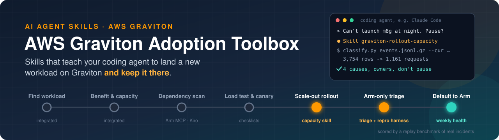
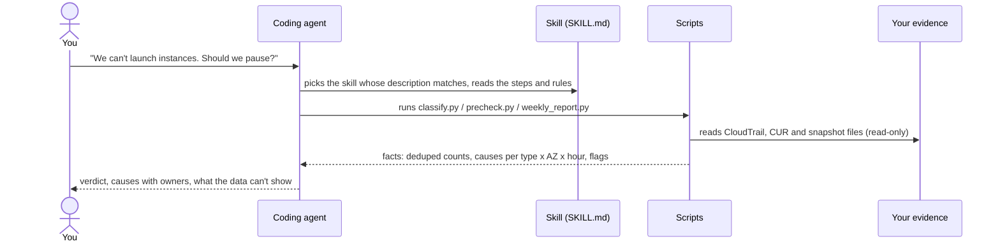
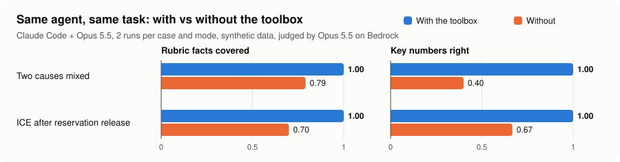
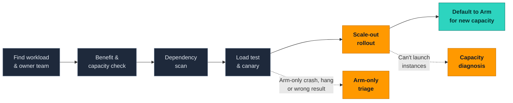

<p align="center">
  
</p>

<p align="center">
  <b>English</b> · <a href="README_CN.md">简体中文</a>
</p>

<p align="center">
  
  
  
  
  
  
</p>

> [!WARNING]
> **Early development.** v0.1 round 2 is in: see the [test report](docs/test-report-2026-11-04-r2.md). Not ready for production use yet.

## What it is

**AI agent skills for AWS Graviton.** Add them to a coding agent (tested so far: Claude Code). The agent can then:
- diagnose launch failures during a Graviton rollout,
- check readiness before a rollout, and
- track adoption every week.

It works from your own CloudTrail and CUR evidence and takes minutes. The agent does the reasoning and the skill's scripts produce the numbers, so the answer can be checked.

## See it work

A real run from the end-to-end test, on the synthetic sample case. Claude Code was given only the question below; it found and used the skill by itself.

```text
you    › Our Auto Scaling groups fail to launch m8g.24xlarge at night since the Graviton
         rollout started. Evidence is in ./input. Why, and should we pause?

agent  · loads skill   graviton-rollout-capacity
agent  · runs          classify.py input/events.jsonl.gz --subnet-map … --capacity-snapshot … --cur …
                       3,754 rows -> 1,161 unique requests (334 duplicate records, 2,259 repeated rows)

agent  › Short answer: don't pause. This is not a Graviton problem. At night, AWS has no free
         m8g.24xlarge capacity in eu-west-1a or eu-west-1b. Use fallback sizes and plan
         capacity reservations, and the rollout can keep going.

         1  m8g.24xlarge, both AZs, 20:00-01:59   375 InsufficientInstanceCapacity (210 + 165)
            -> fallbacks + reservations in batches. Not a quota problem.     owner: platform + account team
         2  m8g.16xlarge, eu-west-1a, 01:00-02:59  90 capacity errors while the snapshot shows 240 free
            -> pool size does not explain it; send the evidence to the TAM.  owner: account team
         3  c8g.4xlarge, eu-west-1b                36 VcpuLimitExceeded -> raise the vCPU quota
         4  m8g.16xlarge, eu-west-1b               15 InsufficientFreeAddressesInSubnet -> add IP space

         What the data can't show: why #2 happens; fallback capacity at night; ASG settings.
```

<sub>Shortened from the [full answer](replay-bench/results/2026-11-04-r2/e2e/quickstart-proj.answer.md). Every number matches the case's [expected answer](replay-bench/cases/ice-two-causes/answer.json).</sub>

## How the agent uses it



**Why skills and not just a prompt:** the skill gives the agent the procedure, the rules and the traps, for example "`InsufficientInstanceCapacity` is not a quota problem". The scripts give it numbers it can trust. Without them, the same model reasons well but miscounts. See below.

## Does it help?

Same agent, same task, run with and without the toolbox. The rubric was written before the runs and graded by a model judge. Full report: [round 2](docs/test-report-2026-11-04-r2.md).

<picture>
  <source media="(prefers-color-scheme: dark)" srcset="assets/replay-results-dark.svg">
  
</picture>

| Case | Facts covered (with / without) | Key numbers right (with / without) | Time, s (with / without) |
|---|---|---|---|
| Two causes mixed | **1.00** / 0.79 | **1.00** / 0.40 | 108 / 135 |
| ICE after reservation release | **1.00** / 0.70 | **1.00** / 0.67 | 77 / 92 |

Without the toolbox, the agent's per-night failure counts were 3-6x too high, because it did not merge repeated rows of the same request. Small sample (2 cases x 2 runs), synthetic data. Read the report's limits section before quoting these numbers.

The toolbox uses the [Agent Skills](https://agentskills.io) format, which Claude Code, Kiro, Codex and GitHub Copilot all read. So far it has been tested with Claude Code only.

## Quick start (Claude Code)

Requirements: Claude Code, Python 3.9+ (standard library only). For your own account data, the read-only permissions in [`graviton-rollout-capacity/iam/readonly-policy.json`](graviton-rollout-capacity/iam/readonly-policy.json).

1. **Install the skills.** For one project, copy them into the project's `.claude/skills/`; for all projects, use `~/.claude/skills/` instead:

   ```bash
   git clone https://github.com/tsaol/aws-graviton-adoption-toolbox.git
   mkdir -p .claude/skills
   cp -r aws-graviton-adoption-toolbox/graviton-playbook aws-graviton-adoption-toolbox/graviton-rollout-capacity .claude/skills/
   ```

2. **Try it on the sample case** (synthetic data):

   ```bash
   cp -r aws-graviton-adoption-toolbox/replay-bench/cases/ice-two-causes/input ./input
   claude "Our Auto Scaling groups fail to launch m8g.24xlarge at night since the Graviton rollout started. Evidence is in ./input. Why, and should we pause?"
   ```

   Claude picks up `graviton-rollout-capacity` by itself, runs `classify.py` and answers with the causes, an owner for each action, and what the data cannot show. Expected findings for this case are in [`answer.json`](replay-bench/cases/ice-two-causes/answer.json).

3. **Use it on your own account.** Export `RunInstances` events with `aws cloudtrail lookup-events` (or use your CloudTrail S3 files), plus the subnet map and, if you have it, hourly CUR usage. See [`graviton-rollout-capacity/SKILL.md`](graviton-rollout-capacity/SKILL.md) for every command, the pre-rollout check and the weekly report.

Kiro, Codex and GitHub Copilot use the same Agent Skills format, but the toolbox has **not been tested** with them yet.

## Why this exists

Most Graviton tools stop when the code builds. Real adoption projects usually stall **after** that point: instances can't launch at peak, or a crash shows up only on Arm, and the customer asks whether to pause.

| | Typical migration tools | This toolbox |
|---|---|---|
| Question answered | *Does my code run on Arm?* | *Will this workload land at scale and stay on Arm?* |
| Stages covered | Scan, convert, build | Every stage, from finding the workload to making Arm the default for new capacity |
| After the build passes | Mostly out of scope | Rollout & capacity diagnosis, Arm-only failure triage |
| Proof that it helps | Demos | A replay benchmark of real incidents, run with and without the toolbox |

## The adoption journey



<sub>Grey = existing tools, integrated rather than rebuilt · Orange = original to this toolbox · Teal = weekly adoption health</sub>

## What's in the box

| | Part | What it does | Source |
|---|---|---|---|
| 🧭 | [`graviton-playbook/`](graviton-playbook/) | Entry skill. Asks where you are stuck, routes you to the right stage tool, and names the decision the customer has to make at each stage | Original |
| 🔌 | [`integrations/`](integrations/) | How to call [Arm MCP Server](https://github.com/arm/mcp) / Kiro Graviton Migration Power, AWS Transform custom (Java), graviton-readiness and the Graviton Savings Dashboard | Integrated |
| 📏 | [`references/`](references/) | Benchmark comparison checklist (same AZ, same size class, normalized per unit of traffic, pass bars agreed up front) and a canary checklist | Original |
| 🚀 | [`graviton-rollout-capacity/`](graviton-rollout-capacity/) | **Rollout & capacity skill.** Uses CloudTrail request evidence (and CUR hourly usage) to tell insufficient capacity from quota from other errors. Also: a pre-rollout check (7 checks, PASS / FAIL / NOT RUN), reservation batch planning, a daily rollout page and a weekly adoption health report. Ships a read-only IAM policy | ⭐ Original |
| 🔬 | [`arm-only-failure-triage/`](arm-only-failure-triage/) | **Arm-only failure triage skill + repro harness.** Rules out memory ordering, compiler bugs, allocator mix-ups, `char` signedness, floating point and wrong native libraries, with a repro on both x86 and Graviton, before naming a root cause | ⭐ Original |
| 🏁 | [`replay-bench/`](replay-bench/) | **Replay benchmark.** Sanitized real incidents and public post-mortems. Each case is run with and without the toolbox and scored on root cause, time taken and wrong claims | ⭐ Original |

## Principles

- **Scripts produce facts; the model makes the judgment.** Dedupe, classification and capacity math happen in scripts, so the results can be checked.
- **Honesty rules.** A check that was not run is reported as `NOT RUN`. No root cause is stated until it has been reproduced on both architectures.
- **Read-only by default.** Skills that touch an AWS account ship a read-only IAM policy (checked against the AWS service authorization reference: Read/List actions only) and never launch instances or change quotas on their own.
- **No customer data.** Fixtures and replay cases are sanitized or synthetic.

## Roadmap

- [x] **v0.1 round 2**: two-layer dedupe, CUR alignment, pre-rollout check, weekly adoption health, read-only IAM policy. [Test report](docs/test-report-2026-11-04-r2.md): 23/23 unit tests; quick start, pre-rollout and weekly runs all used the skill; replay with the toolbox 1.0 vs 0.70-0.79 without (the main failure without it: counts inflated 3-6x)
- [x] **v0.1 first cut**: `graviton-playbook` + `graviton-rollout-capacity` + 2 replay cases. [Test report](docs/test-report-2026-11-04.md): 13/13 unit tests pass; with the toolbox, Opus 5.5 covered every rubric fact in 4/4 runs (score 1.0, vs 0.90-0.92 without), about 10-15% faster
- [ ] **v0.2**: `arm-only-failure-triage` + repro harness, 5 replay cases
- [ ] **Later**: benchmark comparison checklist, weekly adoption report, 20+ replay cases, results for Kiro / Claude Code / Codex / Copilot

## Security

See [CONTRIBUTING](CONTRIBUTING.md#security-issue-notifications) for more information.

## License

This library is licensed under the MIT-0 License. See the LICENSE file.
