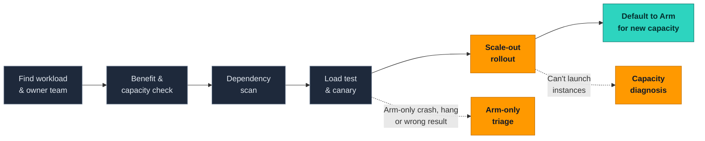

  

  <b>English</b> · <a href="README_CN.md">简体中文</a>

  
  
  
  
  

> [!WARNING]
> **Early development (v0.1 in progress).** Nothing here is ready for production use yet.

## Why this exists

Most Graviton tools stop when the code builds. Real adoption projects usually stall **after** that point: instances can't launch at peak, or a crash shows up only on Arm, and the customer asks whether to pause.

| | Typical migration tools | This toolbox |
|---|---|---|
| Question answered | *Does my code run on Arm?* | *Will this workload land at scale and stay on Arm?* |
| Stages covered | Scan, convert, build | Every stage, from finding the workload to making Arm the default for new capacity |
| After the build passes | Mostly out of scope | Rollout & capacity diagnosis, Arm-only failure triage |
| Proof that it helps | Demos | A replay benchmark of real incidents, run with and without the toolbox |

## The adoption journey

Grey = existing tools, integrated rather than rebuilt · Orange = original to this toolbox · Teal = weekly adoption health

## What's in the box

| | Part | What it does | Source |
|---|---|---|---|
| 🧭 | [`graviton-playbook/`](graviton-playbook/) | Entry skill. Asks where you are stuck, routes you to the right stage tool, and names the decision the customer has to make at each stage | Original |
| 🔌 | [`integrations/`](integrations/) | How to call [Arm MCP Server](https://github.com/arm/mcp) / Kiro Graviton Migration Power, AWS Transform custom (Java), graviton-readiness and the Graviton Savings Dashboard | Integrated |
| 📏 | [`references/`](references/) | Benchmark comparison checklist (same AZ, same size class, normalized per unit of traffic, pass bars agreed up front) and a canary checklist | Original |
| 🚀 | [`graviton-rollout-capacity/`](graviton-rollout-capacity/) | **Rollout & capacity skill.** Uses CloudTrail request evidence to tell insufficient capacity from quota from other errors, then gives a pre-rollout check, reservation batch planning, a daily rollout page and a weekly adoption health report | ⭐ Original |
| 🔬 | [`arm-only-failure-triage/`](arm-only-failure-triage/) | **Arm-only failure triage skill + repro harness.** Rules out memory ordering, compiler bugs, allocator mix-ups, `char` signedness, floating point and wrong native libraries, with a repro on both x86 and Graviton, before naming a root cause | ⭐ Original |
| 🏁 | [`replay-bench/`](replay-bench/) | **Replay benchmark.** Sanitized real incidents and public post-mortems. Each case is run with and without the toolbox and scored on root cause, time taken and wrong claims | ⭐ Original |

## Principles

- **Scripts produce facts; the model makes the judgment.** Dedupe, classification and capacity math happen in scripts, so the results can be checked.
- **Honesty rules.** A check that was not run is reported as `NOT RUN`. No root cause is stated until it has been reproduced on both architectures.
- **Read-only by default.** Skills that touch an AWS account ship a read-only IAM policy and never launch instances or change quotas on their own.
- **No customer data.** Fixtures and replay cases are sanitized or synthetic.

## Roadmap

- [ ] **v0.1**: `graviton-playbook` + `graviton-rollout-capacity` + 2 replay cases, plus a "which existing tool to use" table for the other stages
- [ ] **v0.2**: `arm-only-failure-triage` + repro harness, 5 replay cases
- [ ] **Later**: benchmark comparison checklist, weekly adoption report, 20+ replay cases, results for Kiro / Claude Code / Codex / Copilot

## Security

See [CONTRIBUTING](CONTRIBUTING.md#security-issue-notifications) for more information.

## License

This library is licensed under the MIT-0 License. See the LICENSE file.
