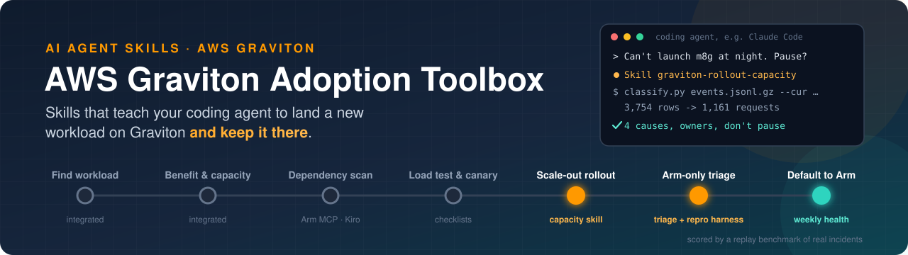
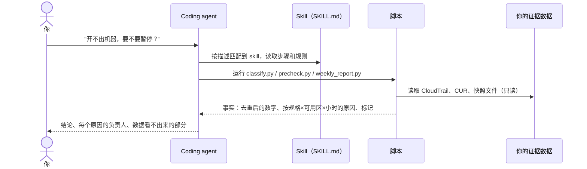
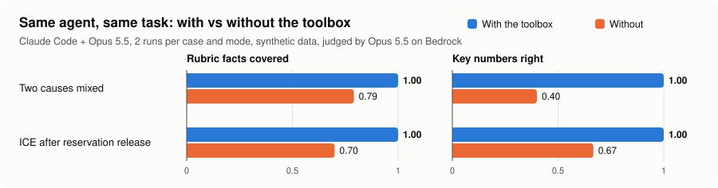
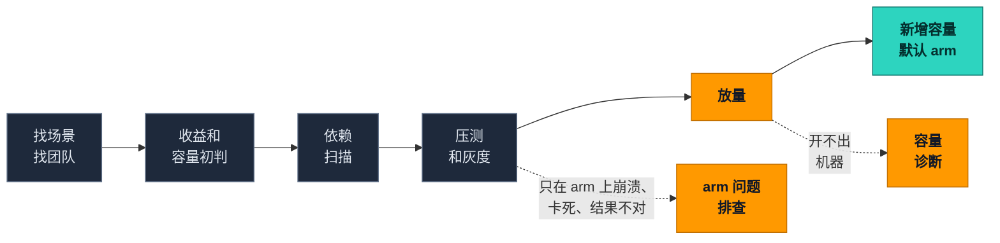

<p align="center">
  
</p>

<p align="center">
  <a href="README.md">English</a> · <b>简体中文</b>
</p>

<p align="center">
  
  
  
  
  
  
</p>

> [!WARNING]
> **开发早期**：v0.1 第二轮已完成，见[测试报告](docs/test-report-2026-11-04-r2.md)。还不能用于生产。

## 这是什么

**给 AI agent 用的 AWS Graviton skills。** 把它装进 coding agent（目前测过 Claude Code），agent 就能用你自己的 CloudTrail 和 CUR 数据做三件事：
- 诊断 Graviton 放量时开不出机器的原因；
- 放量前检查是否准备好；
- 每周跟踪采用情况。

几分钟就能出结果。agent 负责推理，skill 里的脚本负责算数，所以结论可以复查。

## 看它怎么工作

下面是端到端测试里的一次真实运行，用的是构造的样例数据。题目里只给了这一个问题，Claude Code 自己找到并用上了 skill。

```text
你     › Graviton 放量以后，我们的 Auto Scaling 组每晚都开不出 m8g.24xlarge。
         证据在 ./input 里。为什么？要不要暂停？

agent  · 加载 skill    graviton-rollout-capacity
agent  · 运行          classify.py input/events.jsonl.gz --subnet-map … --capacity-snapshot … --cur …
                       3,754 行 -> 1,161 个请求（334 条重复记录，2,259 行同一请求的重复行）

agent  › 结论：不要暂停。这不是 Graviton 的问题，是晚上 eu-west-1a 和 1b 都没有空闲的
         m8g.24xlarge。加备用规格、分批做预留，放量可以继续。

         1  m8g.24xlarge，两个可用区，20:00-01:59   375 次容量不足（210 + 165）
            -> 备用规格 + 分批预留；不是配额问题。            负责：平台团队 + 客户团队
         2  m8g.16xlarge，eu-west-1a，01:00-02:59   快照显示有 240 台空闲，仍有 90 次容量不足
            -> 池子大小解释不了，把证据交给 TAM。             负责：客户团队
         3  c8g.4xlarge，eu-west-1b                 36 次 VcpuLimitExceeded -> 提高 vCPU 配额
         4  m8g.16xlarge，eu-west-1b                15 次 InsufficientFreeAddressesInSubnet -> 加 IP

         数据看不出来的：第 2 项的原因；备用规格晚上有没有空闲；ASG 的配置。
```

<sub>节选自[完整答案](replay-bench/results/2026-11-04-r2/e2e/quickstart-proj.answer.md)（英文），中文是转述。每个数字都和这道题的[标准答案](replay-bench/cases/ice-two-causes/answer.json)一致。</sub>

## agent 怎么用它



**为什么用 skill，而不是只写一段提示词**：skill 给 agent 的是步骤、规则和容易踩的坑，比如"容量不足不是配额问题"；脚本给它可以信任的数字。没有这些，同一个模型推理照样不错，但数字会算错，见下面的结果。

## 有没有用

同一个 agent、同一道题，装工具箱和不装工具箱各跑一遍。评分标准是跑之前写好的，由模型评审打分。完整报告见[第二轮测试报告](docs/test-report-2026-11-04-r2.md)。

<picture>
  <source media="(prefers-color-scheme: dark)" srcset="assets/replay-results-dark.svg">
  
</picture>

| 题 | 评分项覆盖率（装 / 不装） | 关键数字答对（装 / 不装） | 用时，秒（装 / 不装） |
|---|---|---|---|
| 两类原因混在一起 | **1.00** / 0.79 | **1.00** / 0.40 | 108 / 135 |
| 释放预留后复发 | **1.00** / 0.70 | **1.00** / 0.67 | 77 / 92 |

不装工具箱时，agent 没有合并同一请求的重复行，每晚的失败数被放大了 3 到 6 倍。样本小（2 道题，每种跑 2 次），数据是构造的；引用这些数字前，请先看报告里的局限说明。

工具箱用的是 [Agent Skills](https://agentskills.io) 格式，Claude Code、Kiro、Codex、GitHub Copilot 都能读。目前只在 Claude Code 上测过。

## 快速开始（Claude Code）

前提：Claude Code、Python 3.9+（只用标准库）。用你自己的账号数据时，需要 [`graviton-rollout-capacity/iam/readonly-policy.json`](graviton-rollout-capacity/iam/readonly-policy.json) 里的只读权限。

1. **安装 skill**：只给一个项目用，就复制到项目的 `.claude/skills/`；所有项目都用，就复制到 `~/.claude/skills/`：

   ```bash
   git clone https://github.com/tsaol/aws-graviton-adoption-toolbox.git
   mkdir -p .claude/skills
   cp -r aws-graviton-adoption-toolbox/graviton-playbook aws-graviton-adoption-toolbox/graviton-rollout-capacity .claude/skills/
   ```

2. **用样例数据试一次**（构造的数据）：

   ```bash
   cp -r aws-graviton-adoption-toolbox/replay-bench/cases/ice-two-causes/input ./input
   claude "Graviton 放量以后，我们的 Auto Scaling 组每晚都开不出 m8g.24xlarge。证据在 ./input 里。为什么？要不要暂停？"
   ```

   Claude 会自己用上 `graviton-rollout-capacity`，跑 `classify.py`，给出原因分类、每个动作的负责人，以及数据看不出来的部分。这道题的标准答案在 [`answer.json`](replay-bench/cases/ice-two-causes/answer.json)。

3. **用在自己的账号上**：用 `aws cloudtrail lookup-events` 导出 `RunInstances` 事件（或者直接用 CloudTrail 的 S3 日志文件），再加上子网对照表，有的话再加 CUR 小时用量。所有命令、放量前检查和每周报表见 [`graviton-rollout-capacity/SKILL.md`](graviton-rollout-capacity/SKILL.md)。

Kiro、Codex、GitHub Copilot 用的是同一种 Agent Skills 格式，但工具箱**还没有在它们上面测过**。

## 为什么做这个

大多数 Graviton 工具到"代码编过了"就停了。可真实的采用项目，往往卡在**这之后**：高峰时开不出机器，或者程序只在 arm 上崩溃，客户开始问"要不要暂停"。

| | 常见的迁移工具 | 这个工具箱 |
|---|---|---|
| 回答的问题 | 我的代码能不能在 arm 上跑？ | 这个业务能不能大规模放上去，并且一直留在 arm 上？ |
| 覆盖的阶段 | 扫描、转换、构建 | 全部阶段：从找场景一直到新增容量默认 arm |
| 编过之后 | 基本不管 | 放量和容量诊断、arm 上的问题排查 |
| 怎么证明有用 | 演示 | 用真实故障做回放考题，装工具箱和不装工具箱各跑一遍 |

## 采用的全过程



<sub>灰色＝现成工具，直接集成，不重写 · 橙色＝工具箱自研 · 青色＝每周采用健康度</sub>

## 工具箱里有什么

| | 部分 | 做什么 | 来源 |
|---|---|---|---|
| 🧭 | [`graviton-playbook/`](graviton-playbook/) | 总入口 skill：先问清卡在哪一步，再带到对应阶段的工具；每一步写明客户要做什么决策 | 自研 |
| 🔌 | [`integrations/`](integrations/) | 怎么调用 [Arm MCP Server](https://github.com/arm/mcp) / Kiro Graviton Migration Power、AWS Transform custom（Java）、graviton-readiness、Graviton Savings Dashboard | 集成 |
| 📏 | [`references/`](references/) | 性能对比口径检查清单（同可用区、同规格档位、按单位流量归一化、过关线事先定好）、灰度检查表 | 自研 |
| 🚀 | [`graviton-rollout-capacity/`](graviton-rollout-capacity/) | **放量和容量 skill**：用 CloudTrail 请求记录（可加 CUR 小时用量）区分容量不足、配额和其他错误；另有放量前检查（7 项，PASS / FAIL / NOT RUN）、预留分批推演、每日放量页、每周采用健康度报表；附只读 IAM 策略 | ⭐ 自研 |
| 🔬 | [`arm-only-failure-triage/`](arm-only-failure-triage/) | **arm 问题排查 skill + 复现 harness**：逐个排除内存序、编译器 bug、分配器混用、`char` 符号、浮点、错误的 native 库，在 x86 和 Graviton 上都复现后才下根因结论 | ⭐ 自研 |
| 🏁 | [`replay-bench/`](replay-bench/) | **回放考题**：脱敏的真实故障和公开的事后复盘；每题装工具箱和不装工具箱各跑一遍，按根因对错、用时、错误结论打分 | ⭐ 自研 |

## 原则

- **脚本出事实，模型做判断**：去重、分类、容量计算用脚本，结果可以复查。
- **诚实条款**：没跑的检查写 `NOT RUN`；没在两种架构上复现，不写根因。
- **默认只读**：碰 AWS 账号的 skill 都附只读 IAM 策略（已对照 AWS 服务授权参考核对，只有 Read/List 操作），不会自己开机器或改配额。
- **不放客户数据**：测试数据和回放题都是脱敏的或构造的。

## 路线图

- [x] **v0.1 第二轮**：两层去重、CUR 对齐、放量前检查、每周采用健康度、只读 IAM 策略。[测试报告](docs/test-report-2026-11-04-r2.md)：23/23 单元测试通过；快速开始、放量前、每周报表三个端到端测试都用上了 skill；回放对比装工具箱 1.0、不装 0.70–0.79（不装时最主要的问题是数字被放大 3–6 倍）
- [x] **v0.1 第一版**：`graviton-playbook` + `graviton-rollout-capacity` + 2 道回放题。[测试报告](docs/test-report-2026-11-04.md)：13/13 单元测试通过；装了工具箱，Opus 5.5 在 4/4 次运行中答对全部评分项（1.0，不装时为 0.90–0.92），快约 10–15%
- [ ] **v0.2**：`arm-only-failure-triage` + 复现 harness，5 道回放题
- [ ] **之后**：口径检查清单、每周采用报表、20 道以上回放题、Kiro / Claude Code / Codex / Copilot 各自的成绩

## Security

见 [CONTRIBUTING](CONTRIBUTING.md#security-issue-notifications)。

## License

本项目使用 MIT-0 许可证，见 LICENSE 文件。
