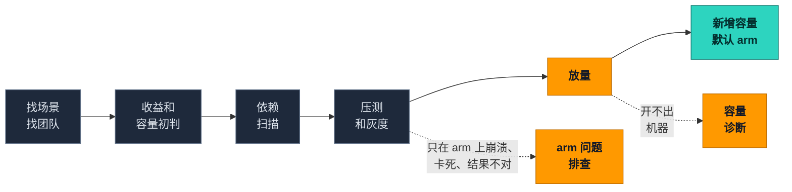

  

  <a href="README.md">English</a> · <b>简体中文</b>

  
  
  
  
  

> [!WARNING]
> **开发早期（v0.1 进行中）**，还不能用于生产。

## 为什么做这个

大多数 Graviton 工具到"代码编过了"就停了。可真实的采用项目，往往卡在**这之后**：高峰时开不出机器，或者程序只在 arm 上崩溃，客户开始问"要不要暂停"。

| | 常见的迁移工具 | 这个工具箱 |
|---|---|---|
| 回答的问题 | 我的代码能不能在 arm 上跑？ | 这个业务能不能大规模放上去，并且一直留在 arm 上？ |
| 覆盖的阶段 | 扫描、转换、构建 | 全部阶段：从找场景一直到新增容量默认 arm |
| 编过之后 | 基本不管 | 放量和容量诊断、arm 上的问题排查 |
| 怎么证明有用 | 演示 | 用真实故障做回放考题，装工具箱和不装工具箱各跑一遍 |

## 采用的全过程

灰色＝现成工具，直接集成，不重写 · 橙色＝工具箱自研 · 青色＝每周采用健康度

## 工具箱里有什么

| | 部分 | 做什么 | 来源 |
|---|---|---|---|
| 🧭 | [`graviton-playbook/`](graviton-playbook/) | 总入口 skill：先问清卡在哪一步，再带到对应阶段的工具；每一步写明客户要做什么决策 | 自研 |
| 🔌 | [`integrations/`](integrations/) | 怎么调用 [Arm MCP Server](https://github.com/arm/mcp) / Kiro Graviton Migration Power、AWS Transform custom（Java）、graviton-readiness、Graviton Savings Dashboard | 集成 |
| 📏 | [`references/`](references/) | 性能对比口径检查清单（同可用区、同规格档位、按单位流量归一化、过关线事先定好）、灰度检查表 | 自研 |
| 🚀 | [`graviton-rollout-capacity/`](graviton-rollout-capacity/) | **放量和容量 skill**：用 CloudTrail 请求记录区分容量不足、配额和其他错误；放量前检查、预留分批推演、每日放量页、每周采用健康度报表 | ⭐ 自研 |
| 🔬 | [`arm-only-failure-triage/`](arm-only-failure-triage/) | **arm 问题排查 skill + 复现 harness**：逐个排除内存序、编译器 bug、分配器混用、`char` 符号、浮点、错误的 native 库，在 x86 和 Graviton 上都复现后才下根因结论 | ⭐ 自研 |
| 🏁 | [`replay-bench/`](replay-bench/) | **回放考题**：脱敏的真实故障和公开的事后复盘；每题装工具箱和不装工具箱各跑一遍，按根因对错、用时、错误结论打分 | ⭐ 自研 |

## 原则

- **脚本出事实，模型做判断**：去重、分类、容量计算用脚本，结果可以复查。
- **诚实条款**：没跑的检查写 `NOT RUN`；没在两种架构上复现，不写根因。
- **默认只读**：碰 AWS 账号的 skill 都附只读 IAM 策略，不会自己开机器或改配额。
- **不放客户数据**：测试数据和回放题都是脱敏的或构造的。

## 路线图

- [ ] **v0.1**：`graviton-playbook` + `graviton-rollout-capacity` + 2 道回放题；其他阶段先放一张"该用哪个现成工具"的表
- [ ] **v0.2**：`arm-only-failure-triage` + 复现 harness，5 道回放题
- [ ] **之后**：口径检查清单、每周采用报表、20 道以上回放题、Kiro / Claude Code / Codex / Copilot 各自的成绩

## Security

见 [CONTRIBUTING](CONTRIBUTING.md#security-issue-notifications)。

## License

本项目使用 MIT-0 许可证，见 LICENSE 文件。
